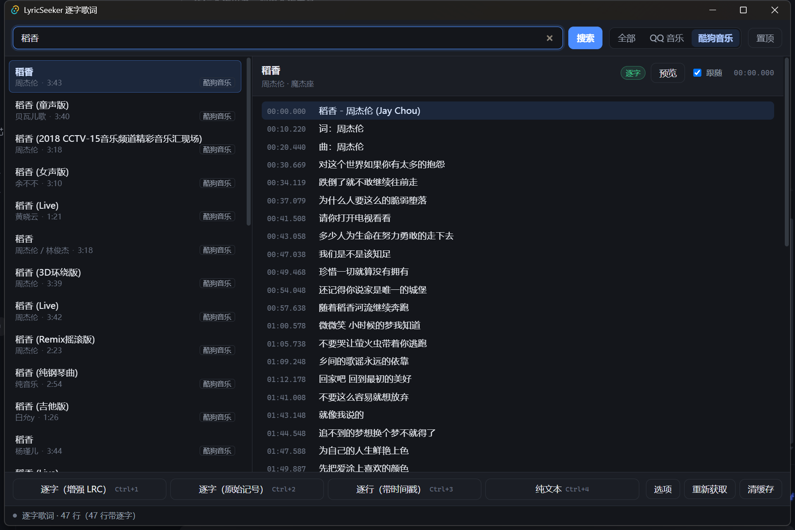
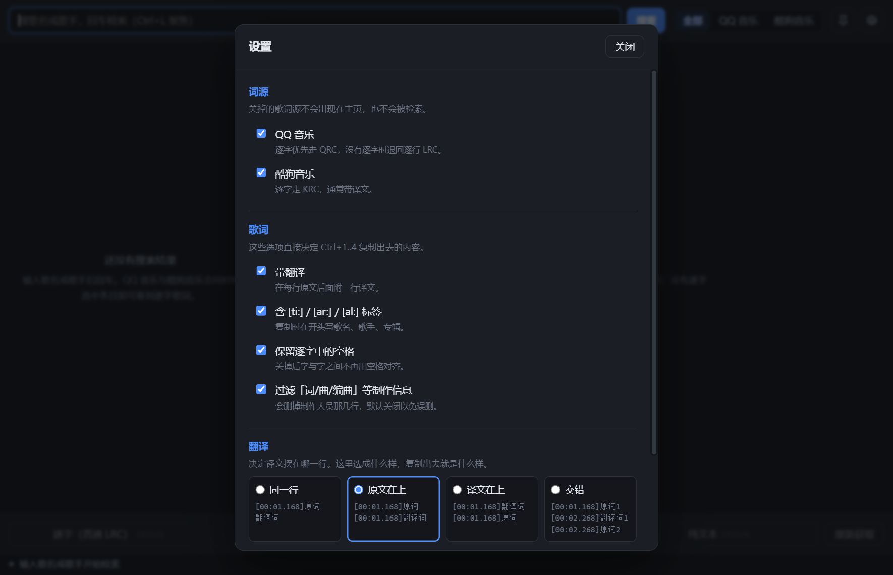

# LyricSeeker 逐字歌词

Windows 上的逐字歌词检索工具。搜歌名或歌手，从 **QQ 音乐** 与 **酷狗音乐** 同时取词，
支持按「逐字歌词」或「逐行歌词」一键复制到剪贴板。



## 功能

- **双源并发搜索**：一次检索同时打 QQ 音乐与酷狗音乐，合并去重，可按来源筛选。
- **逐字歌词**：QQ 走 QRC、酷狗走 KRC，都是真正的逐音节时间轴（不是估算的逐行 LRC）。
- **四种复制格式**（Ctrl+1 ~ Ctrl+4）：
  | 快捷键 | 格式 | 形态 |
  | --- | --- | --- |
  | `Ctrl+1` | 逐字（普通 LRC） | `[00:00.000]晴[00:00.160]天[00:00.320]` |
  | `Ctrl+2` | 逐字（增强 LRC） | `[00:00.000]<00:00.000>晴<00:00.160>天<00:00.320>` |
  | `Ctrl+3` | 逐行（带时间戳） | `[00:00.000]晴天 - 周杰伦 (Jay Chou)` |
  | `Ctrl+4` | 纯文本 | 无任何标记 |

  两种逐字格式都以**末音节的结束时间**收口（上表最后的 `00:00.320`），
  且行末空白会被裁掉 —— 与 LDDC 的输出逐字节一致（见 `tests/compare.rs`）。
- **译文格式**：只取整句的首尾两个时间标签，不做逐字：
  `[00:11.763]如今我的歌在各个电台播放[00:14.355]`。
- **复制选项**：是否带元信息、是否带翻译、是否滤掉「词/曲/编曲」等制作人信息、是否保留空格。
- **右上角两个图标按钮**：图钉 = 窗口置顶（再次点击取消）、齿轮 = 设置页。
  底栏原来的「设置」按钮已移除，入口只保留这一处（另有 `Ctrl+,` 快捷键）。
- **设置页**：标题栏右侧齿轮随时唤起，不用先选中歌曲。分三段——
  - 词源：分别开关 QQ 音乐 / 酷狗音乐，关掉的源既不出现在主页 tab，也不会被检索；
  - 歌词：上文的四个复制选项，默认勾选「带翻译 / 含 `[ti:]` `[ar:]` `[al:]` / 保留逐字中的空格」，默认不勾「过滤制作信息」；
  - 缓存：显示占用大小，可一键清空。

  改动立即写入 `%APPDATA%\com.lyricseeker.app\settings.json`，重启后保持。

  
- **译文**：QQ 与酷狗两源都会带上译文（QQ 从 `GetPlayLyricInfo` 的 `trans` 字段、
  酷狗从 KRC 的 `[language:]` 里解出），预览逐行显示，勾选「含翻译」后复制会附上。
- **逐字预览**：内置走字预览，可跟随当前播放位置高亮。
- **本地缓存**：取到的歌词落盘缓存 24 小时，重复查看不重复请求。
- **全局快捷键** `Ctrl+Alt+L`：随时唤起/隐藏窗口。
- **单实例**：重复启动只会把已有窗口拉到前台。

## 运行

```powershell
npm install
npm run tauri dev        # 开发
npm run tauri build      # 出包
```

产物：

- 绿色版：`src-tauri/target/release/lyricseeker.exe`
- 安装包：`src-tauri/target/release/bundle/nsis/LyricSeeker_0.1.0_x64-setup.exe`

## 技术栈

| 层 | 选型 |
| --- | --- |
| 壳 | Tauri 2（Rust + WebView2） |
| 前端 | React 19 + TypeScript + Vite |
| 歌词解析 | `lyrics-core` / `lyrics-parsers` / `lyrics-crypto` / `lyrics-generators` 0.5.1 |
| HTTP | `reqwest`（native-tls / schannel） |

选 Tauri 而非 Electron：安装包 2.67 MiB、内存占用低；而非 WinUI3：不需要装 .NET SDK，
且歌词解密/解析已有成熟的 Rust crate 可用。

## 目录

```
src/                     前端
  api.ts                 invoke 封装
  types.ts               数据模型与常量
  App.tsx                主状态机 + 快捷键
  components/            SearchBar / SongList / LyricPreview / CopyBar / StatusBar / Toast
  styles.css             深色主题
src-tauri/               后端
  src/model.rs           AppError / Source / SongCandidate / LyricLine / LyricsDoc
  src/format.rs          四种复制格式的发射器
  src/cache.rs           24h 文件缓存
  src/lyrics.rs          解析 + 降级
  src/providers/qq.rs    QQ 音乐（搜索 + GetPlayLyricInfo）
  src/providers/kugou.rs 酷狗音乐（搜索 + KRC 下载解密）
  src/commands.rs        对前端暴露的命令
  tests/live.rs          联网集成测试（#[ignore]，手动跑）
scripts/                 端到端与截图脚本
docs/                    截图
```

## 测试

```powershell
cd src-tauri
cargo test                                        # 41 个单元测试
cargo test --test live -- --ignored --nocapture   # 联网端到端（真实打 QQ/酷狗）
cargo test --test compare -- --ignored --nocapture # 与 LDDC 范例文件逐字节比对
```

## 已知限制

- 上游接口非官方，QQ 音乐对移动端搜索有风控（`code 2001`），代码里已自动降级到桌面端接口。
- 部分曲目只有逐行 LRC、没有逐字数据，此时界面会提示并允许按逐行复制。
- **译文不是每首歌都有**：中文歌在 QQ / 酷狗两侧大多本来就没有译文（上游没给）；
  有译文的曲目仍可能有几行是空的——那是原曲的制作信息行（`Lyrics by：` 之类）
  或纯音乐段落，上游本身就没填。
- 未签名 exe 首次运行会出现 Windows SmartScreen 提示，点「更多信息 → 仍要运行」即可。
- 缓存目录：`%APPDATA%\com.lyricseeker.app\cache`。缓存带 `schema` 版本号，
  取词逻辑改动后旧缓存会自动失效并重新拉取，不需要手动清。
